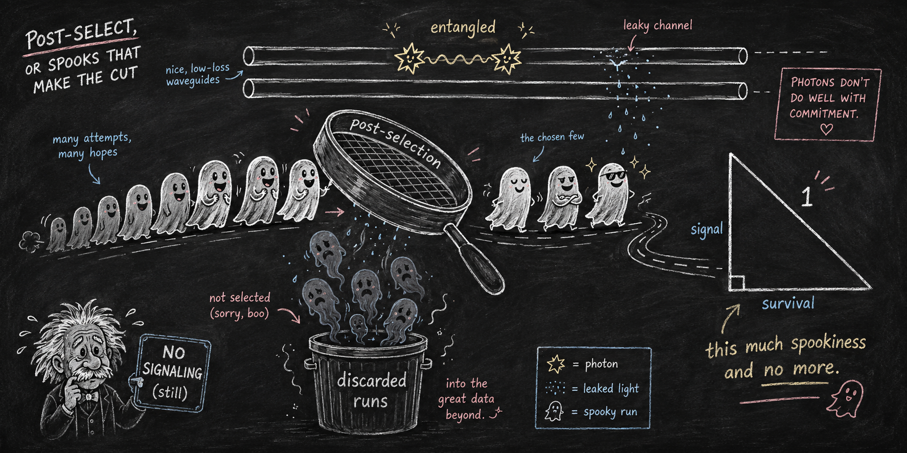

# The price of a post-selected signal

*a sharp survival–distinguishability trade-off, saturated by broken-PT dynamics*



<sub>*Banner image: prompt written by Claude (Anthropic), rendered by ChatGPT (OpenAI).*</sub>

**Paper 4 of the [Indivisible Ghosts program](https://github.com/embeddetech/ghosts-program).** Jonathan Torkelson (2026).

**[Read the paper (PDF)](conditioned-ghosts-paper.pdf)** · LaTeX source in [`paper/`](paper/)

> **Status: working draft.** This manuscript is under the program's release-gate audit and is still being revised. It has not been peer reviewed. Read it accordingly; corrections land here as they are made.

## Abstract

Local lossy (e.g. non-Hermitian) evolution on one arm of an entangled pair cannot signal; conditioning on survival famously produces an apparent signal, whose location in the post-selection is by now well understood. What has been missing is its *price*. We prove a sharp trade-off: for a qubit pair prepared in a Bell state, Alice’s message encoded as a survival effect $`M`$ versus its spatial flip $`XMX`$, the total-variation distance between Bob’s survival-conditioned marginals obeys
``` math
\mathrm{TV}^{2}\;+\;\Bigl(\frac{\sqrt{\det M}}{p}\Bigr)^{2}\;\le\;1 ,
```
where $`p`$ is the survival probability. For dynamics generated by a lossy Hamiltonian, $`\sqrt{\det M}=|\det C|=\exp[-\tfrac12\!\int_0^t\!\mathrm{Tr}\Gamma(s)\,
ds]`$ is the accumulated total-loss factor—a message-independent invariant—so the conditioned signal is bounded exactly by the *anisotropy* of the loss, and anisotropy forces the total-loss factor strictly below the survival probability. The balanced gain/loss ($`\mathcal{PT}`$) dimer saturates the bound at every coupling and every time, in both phases: broken-$`\mathcal{PT}`$ dynamics traces the extremal frontier of post-selected signaling. The classical (configuration-level) signal obeys the *same* bound with a strictly smaller equality set (uncoupled loss), and the two signals close in exact quadrature, $`\mathrm{TV}^{2}=\mathrm{TV}_{\rm cl}^{2}+\chi^{2}`$ with $`\chi`$ the conditioned flip-odd coherence; a coupled broken-phase dimer therefore pays a strict classical deficit, and its classical asymptote reproduces the closed form $`\tilde\kappa/\sin\theta`$ obtained earlier as a corollary of the terminal-indivisibility theorem. We further prove a fidelity-type bound for arbitrary pure inputs and unequal survival probabilities that reduces exactly to the sharp bound at the Bell state, and a general-dimension bound via Lidskii’s theorem, and we report a numerically established failure: the Bell state is *not* extremal at fixed invariants. All statements are verified numerically, including $`\sim1.8\times10^{5}`$ randomized violation searches.

## Reproducing the results

Each script is standalone Python (NumPy/SciPy) and prints its controls inline. The paper's *Code availability* section maps scripts to results.

```
pip install numpy scipy
python scripts/t1_region_sweep.py
```

| Script |
|---|
| [`t1_region_sweep.py`](scripts/t1_region_sweep.py) |

## Audit trail and provenance

This manuscript is an experiment in AI-conducted research: the work was carried out by large language models (Claude, Anthropic), directed and reviewed by the author. The paper's provenance statement says who did what. Nothing here should be taken on trust.

- The audit process: [`AUDIT.md`](AUDIT.md)
- Pass-by-pass audit ledger: [`histories/paper4-history.md`](histories/paper4-history.md)
- The lab-notebook entries for this paper: [`notes-excerpt.md`](notes-excerpt.md)
- The full research notebook, the originating conversation, and every companion paper: the [program hub](https://github.com/embeddetech/ghosts-program)

## License

MIT — see [`LICENSE`](LICENSE).
